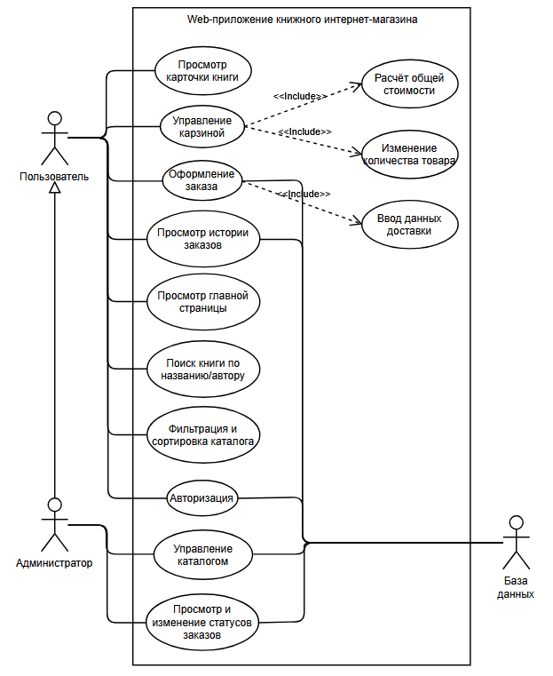
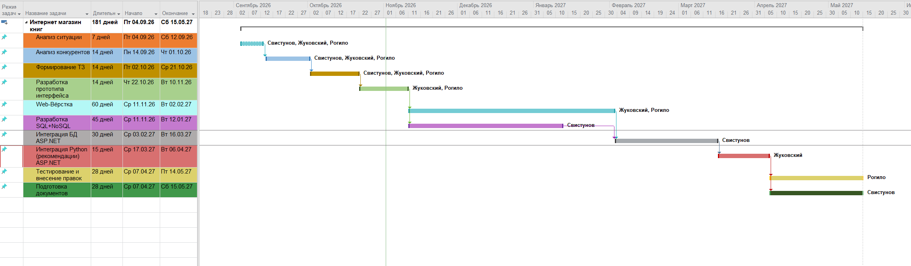

# Книжная гавань (BookShopPRJ) — Web-приложение книжного интернет-магазина

Фронтенд-прототип и проектно-архитектурная база книжного интернет-магазина для удобного поиска изданий, изучения характеристик книг и оформления заказов. Проект решает задачу создания единого пользовательского интерфейса электронной коммерции для розничной продажи книжной продукции.

## Визуализация и проектирование

### Диаграмма вариантов использования (Use Case)
Отражает границы системы и распределение прав доступа между покупателем и администратором:



### Календарный план работ (Диаграмма Ганта)
График этапов разработки проекта с распределением задач между участниками команды:



https://github.com/user-attachments/assets/378d14a0-8496-4aa5-b039-fd75005a3439
## Текущая функциональность

* **Страница карточки товара (`index.html`):** реализована структура детального просмотра книги с отображением обложки, бейджей («Хит продаж», скидка), цены, статуса наличия, счётчика количества и кнопок «В корзину» / «Купить в 1 клик».
* **Блок характеристик и описания:** оформлена таблица параметров издания (автор, серия, количество страниц, формат, издательство, год издания, тип переплёта, ISBN) и блок с аннотацией.
* **Базовые элементы навигации:** свёрстаны сквозная шапка сайта (`Header`) со строкой поиска и разделами («Каталог», «Заказы», «Профиль», «Корзина»), хлебные крошки и подвал (`Footer`).
* **Дизайн и стилизация (`CSS/ index_html-css`):** настроена цветовая палитра интерфейса, типографика и расположение элементов страницы.
* **Архитектурная документация:** подготовлены диаграмма вариантов использования (`UseCaseDiag.png`) и график выполнения работ (`GantTimeline.png`).

## Технологический стек

* **Текущая реализация (Frontend):** HTML5, CSS3.
* **Планируемый стек (в разработке):** JavaScript, Python / ASP.NET (C#), REST API, реляционная СУБД и NoSQL.

## Установка и запуск

Поскольку на текущем этапе проект представляет собой статическую Web-вёрстку, для его запуска не требуется установка серверных зависимостей:

1. Клонируйте репозиторий на локальный компьютер:
```bash
git clone https://github.com
cd BookShopPRJ
```

2. Откройте файл `index.html` в любом современном браузере (Chrome, Яндекс Браузер, Firefox) двойным кликом или с помощью расширения **Live Server** в VS Code.

## Структура проекта

Актуальная структура файлов в репозитории на текущий момент:

```text
BookShopPRJ/
├── CSS/ index_html-css/    # Стили оформления страницы карточки товара и базовых блоков
├── Image/                  # Графические ресурсы и изображения для вёрстки
├── GantTimeline.png        # Диаграмма Ганта (календарный план проекта)
├── UseCaseDiag.png         # Диаграмма вариантов использования системы
├── index.html              # Главный HTML-документ (страница карточки товара)
└── README.md               # Документация проекта
```

## Разработка и вклад

Проект разрабатывается командой студентов группы ИВТ-24 (СибГИУ) по дисциплине «Проектная деятельность 1»:
* **Рогило И.А.** — проектирование интерфейса и Web-вёрстка.
* **Жуковский Е.А.** — проектирование и реализация баз данных.
* **Свистунов А.Д.** — разработка функционала сайта и серверной логики.
